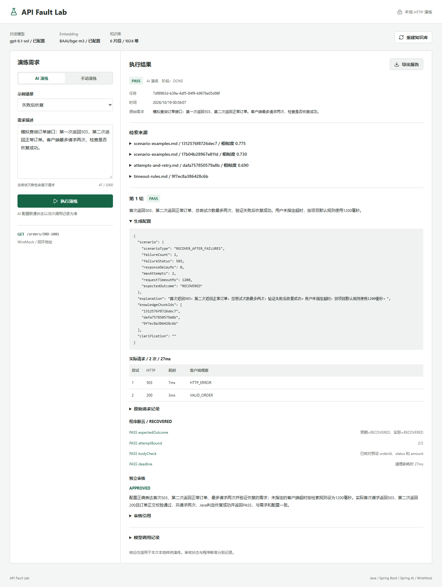
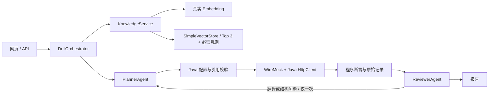

# API Fault Lab

用自然语言描述接口故障，检索项目规则，生成受限配置，在本地执行真实 HTTP，
再由独立审核角色检查需求、配置和记录是否一致。也可以手动运行同一执行器。

**当前状态：2026-10-20 已通过 56 项自动化、真实向量检索、规划/审核双角色、
本地 HTTP 和桌面/窄屏页面验收。省略超时时的默认规则漏检已修复，
隔离规则变更与显式超时优先级均已真实验证；手动 AI 辅助超时边界也已修复。**
准确结果见 [验收记录](docs/验收记录.md)，不能将手动 PASS 或模型桩测试视为真实 AI 验收。
项目未发布到 GitHub。

提示词与人工说明优先中文；两份提示词为 `规划智能体.txt`、`审核智能体.txt`。
字段与枚举保持协议标识，详见 [提示词与配置说明](docs/提示词与配置说明.md)。



当前已运行 56 项自动化测试；既有真实 Edge AI 示例交互与报告下载检查通过。
新增的只读/手动 AI 辅助已通过本地协议桩测试，并在 2026-10-20 的当前配置下完成
各一例真实手动与真实只读调用；这只是具体样例，不代表普遍模型可靠性。
图中是一次真实 AI 与本地 HTTP 演练，不代表模型普遍正确或生产系统可靠。

## 快速运行

Windows PowerShell 5.1+ 或 PowerShell 7+（建议使用 64 位），Java 21+（本机实测 Microsoft OpenJDK 25.0.3）。
固定 Spring Boot 4.1.1 / Spring AI 2.0.1 / Spring Framework 7.0.9 /
Tomcat 11.0.25 / WireMock 3.13.2。Jackson 2.x/3.x 与 Log4j 已覆盖到
当前扫描所需的修复版本。编译 `--release 21`。

```powershell
$ProjectRoot = 'C:\path\to\api-fault-lab'
Set-Location $ProjectRoot
# 有 Maven 时自动使用；也可指定已安装的 mvn.cmd：
$env:MAVEN_CMD = 'C:\path\to\maven\bin\mvn.cmd'
./mvnw.ps1 -B verify
./start.ps1
```

桌面快捷启动：

```powershell
./scripts/create-shortcut.ps1
./launch.ps1
```

快捷入口是桌面上的 `API Fault Lab.lnk`。它只识别本项目 JAR 与
`runtime/server.pid`，已有本项目实例会直接打开其 URL；未运行时才构建/启动本项目。
不会停止端口占用者，也不会启动或控制其他服务。

没有 Maven 时，`mvnw.ps1` 从 Maven Central 下载 Maven 3.9.16 到项目 `.tools/`，
验证 SHA-512，不更改系统安装或 PATH。这是轻量 PowerShell 启动器，不是 Apache Maven Wrapper。
其他电脑通常无需设置 MAVEN_CMD，删除上面那行即可。

`start.ps1` 读取本地 `.env`，默认请求端口 19090；被占用时依次尝试之后 20 个端口，
不停止占用进程。打印的 URL 才是实际地址。仅绑定 `127.0.0.1`。
后台进程 PID 写入 `runtime/server.pid`，日志在 `runtime/server.*.log`。
Windows 可能锁定运行中的 JAR。重新打包前需先结束自己启动的这个应用实例；
脚本不会自动停止进程。只启动第二实例时使用 `./start.ps1 -SkipBuild -Port 19091`。
需要前台运行时可用 `java -jar target/api-fault-lab-0.1.0-SNAPSHOT.jar`，环境变量需先设置。

## 模型配置

在项目目录建立被忽略的 `.env`，按 `.env.example` 填写六项：

```dotenv
AFL_CHAT_BASE_URL=https://your-chat-service.example/v1
AFL_CHAT_MODEL=your-chat-model
AFL_CHAT_API_KEY=
AFL_EMBEDDING_BASE_URL=https://your-embedding-service.example/v1
AFL_EMBEDDING_MODEL=your-embedding-model
AFL_EMBEDDING_API_KEY=
```

Base URL 包含 API 前缀，例如 `/v1`，不包含 `/chat/completions` 或 `/embeddings`。
当前支持 OpenAI 兼容的 Chat Completions（JSON object 输出）与 Embeddings，认证为 Bearer。
对话与 Embedding 可以来自不同服务，必须分别授权、联通，不能假定聊天服务支持 Embedding。
不支持该协议的服务需真实测试后再适配，不能仅改模型名就宣称支持。

更改模型配置需重启本项目进程；不要停止其他项目服务。`.env` 不会被 Java 自动读取，
请通过 `start.ps1` 启动。不要把其他用途密钥自动挪用到这里。
页面只显示配置是否存在，**已配置不表示已联通**。

本机已验证组合：JOJO `gpt-6.1-sol` 对话，硅基流动
`https://api.siliconflow.cn/v1` 的 `BAAI/bge-m3` 向量（1024 维）。
2026-10-19 硅基流动官方价格页将该无 Pro 前缀模型列为免费，
`Pro/BAAI/bge-m3` 单独收费；未读取账号账单，对话费用仍按 JOJO 套餐。
页面默认恢复示例无需填写超时：程序会把真实 Top-3 与 `timeout-rules.md` 的当前规则合并，
模型引用该规则生成数值；用户明确填写的超时优先。

排查当前向量配置可以运行 `./scripts/diagnose-embedding.ps1`：
最多 5 次有界请求，只访问 `.env` 已配置的向量服务，保存状态码和固定诊断标签，
不保存错误正文、不改配置。标准模型对照不是供应商支持声明。
应用错误会保留实际 HTTP 状态码；502/429 本身不能证明密钥错误或供应商不支持整个接口。
此前 JOJO 向量目录未找到候选的失败记录已保留；当前硅基流动配置已真实联通。

## 操作与证据

1. 未配置模型时，切换“手动演练”，选择“失败后恢复”，执行后应看到实际 503、200。
2. 将故障次数改为 2，总尝试次数保留 2，预期仍为恢复，应得到 `FAIL`。
3. 配好模型后，重建知识库，切回 AI 演练，提交示例。检查来源、配置、原始请求和审核。
4. 导出 Markdown 报告。同一任务的原轮次与修订轮次均保留。

```powershell
# 真实远端 AI 端到端门禁；缺配置会退出 2 并记录 NOT_VERIFIED
./scripts/verify-live-ai.ps1 -BaseUrl http://127.0.0.1:19090
# 真实模型规则变更门禁，使用临时知识副本和独立应用进程
./scripts/verify-rag-change.ps1
```

人工修改 `knowledge/timeout-rules.md` 的 LAB-DEFAULT-TIMEOUT 值并重建，可以学习索引失效过程。
源码没有为 AI 硬编码该默认超时。观察检索片段及生成值是否真的更新；
模型未遵守就记录 FAIL，不覆盖历史证据。

## 核心流程



手动模式直接走校验与执行、不调用 RAG；之后可调用一次受约束的 AI 辅助解释需求、
手动配置与执行摘要。真实只读模式仅把 HTTP 状态、耗时、记录数与结构/字段断言布尔值
发送给 AI，不发送设备 ID、传感器值、采样时间或响应正文。两种辅助输出都只解释证据，
不能产生或覆盖执行配置和 Java PASS/FAIL；AI 失败时保留 Java 结果并单独标记 `FAILED`。
AI 演练中规划和审核使用同一配置模型的独立请求，不同系统指令。正常两次对话，最多四次；
两轮 HTTP 演练。服务失败立即结束，
结构/引用/配置错误只允许一次修正。`EVIDENCE_INSUFFICIENT` 不触发为了 PASS 的重试。

审核不能改写 Java 断言。`FAIL + APPROVED` 合法：例如失败两次但只允许两次请求，
结论 FAIL 完全符合原始需求与证据。
Java 能验证字段、引用及审核提出的原文摘录，无法形式化证明自然语言翻译一定正确。

## 范围

| 参数 | 约束 |
|---|---|
| 场景 | NORMAL / CONTINUOUS_ERROR / DELAY / RECOVER_AFTER_FAILURES |
| 总尝试次数 | 1..5，包含首次 |
| 故障次数 | 恢复场景 1..3，其他为 0 |
| 错误码 | 500 / 502 / 503 / 504 |
| 延迟 | 0..3000ms，仅 DELAY |
| 单次超时 | 100..5000ms |
| 每轮执行截止时间 | 30 秒，独立 WireMock，finally 清理 |
| 目标 | 固定 GET /orders/ORD-1001，不接受外部地址 |
| 成功正文 | 固定 orderId、status、amount 检查 |

预期 `SUCCESS` 表示首次成功，`RECOVERED` 表示失败后成功，
`EXHAUSTED` 表示 5xx 耗尽，`TIMEOUT` 表示全部超时。这些是断言目标，不是模型预测。
超时请求的 WireMock 日志可能尚未完成记录，应同时看客户端尝试，不能把日志条数等同返回条数。

知识按标题分节、每 600 字符切片、重叠 60；最多 20 个文件 / 64 片段。
查询保留真实向量 Top-3，再按 chunkId 去重补入 `timeout-rules.md` 的当前片段。
补入片段的相似度为 null，避免把必需规则标成排名命中；最终上下文最多 8 片，
超限明确失败。缺少规则文件时不会生成假片段或硬编码默认值，必要时由模型要求澄清。
缓存绑定知识指纹、Embedding 服务和模型，验证维度及索引文件摘要。重启后惰性加载，
一条维度探测加一条查询，无需每次打开页面重建。分数是余弦相似度，不是准确率。
维度一致不能发现供应商以同一模型名悄悄更换语义空间，遇到此情况应手动重建。

只允许一个演练或建库任务运行。报告 JSON 在 `runtime/reports/`；
内存保留最近约 100 条，其余仍可凭 UUID 从本地读取。没有数据库、登录或云部署。

## API

| 方法与路径 | 行为 |
|---|---|
| GET /api/status | 配置存在性、知识状态、忙碌状态、脱敏调用元数据 |
| POST /api/knowledge/rebuild | 重建，忙碌 409，模型错误 502 |
| POST /api/drills | 同步有界演练；`requirement` 与 `manualScenario` 均为 JSON 字段 |
| GET /api/drills/{id} | 同一任务的记录与轮次 |
| GET /api/drills/{id}/report | Markdown 下载 |
| GET /api/read-only/status | 已核实的本地只读目标元数据 |
| POST /api/read-only/config | 仅保存设备 ID；地址、方法、路径由程序固定 |
| POST /api/read-only/run | 低频串行执行 1..3 次固定 GET，保存脱敏摘要与独立 AI 辅助状态 |
| GET /api/read-only/{id}/report | 导出只读测试摘要，不含遥测正文 |

AI 请求设置 `manualScenario:null`，手动请求见 `examples/`。模型错误可能以 HTTP 200 的报告返回
`status=MODEL_ERROR`，因此不能以 HTTP 200 代替业务成功。参数无效 400、忙碌 409、记录不存在 404。
报告状态还有 PASS / FAIL / EXECUTION_ERROR / NEEDS_CLARIFICATION / INCOMPLETE；审核另存。

“真实只读”模式只允许预先固定的本机 `GET /api/sensor/page?current=1&size=1&deviceId=...`
目标（默认 `http://127.0.0.1:8080`），设备 ID 只能使用安全字符，模型不能生成 URL、主机、
方法或请求头。每轮最多 3 次串行 GET，不做压测、并发、断网、故障注入或登录猜测。
当前目标服务应提供稳定的分页响应；目标服务可能为每次请求追加访问审计记录，
这项副作用会在报告中明确说明。设备 ID 仅保存在被忽略的本地目标配置中；
工具不会把传感器值、采样时间、设备 ID 或响应正文发送给模型或写入测试报告；模型只接收
HTTP 状态、耗时、记录数与结构/字段断言布尔值。AI 辅助不能生成目标或更改程序断言。

## 测试与学习

```powershell
./mvnw.ps1 -B verify
# 可选浏览器验收：安装 Playwright 后使用，脚本不拦截或伪造网络
npm install --prefix .tools/qa --no-save playwright
$env:AFL_PLAYWRIGHT_PATH = "$PWD/.tools/qa/node_modules/playwright"
# 默认需对应 Chromium；也可显式复用本机 Edge：
$env:AFL_BROWSER_EXECUTABLE = 'C:\Program Files (x86)\Microsoft\Edge\Application\msedge.exe'
node scripts/ui-check.cjs
```

`ui-check.cjs` 的页面等待默认是 120 秒，以覆盖真实模型辅助调用的正常延迟；
可用 `AFL_UI_WAIT_TIMEOUT_MS` 覆盖。这个等待预算只属于浏览器验收，不会改变 Java
演练器的 30 秒单轮执行截止时间。

浏览器脚本会提交真实本地演练、导出并核对报告、检查桌面/390px 布局及模型未配置错误。
它不会自动消费已配置的远端模型额度。截图和检查 JSON 位于 `runtime/evidence/`，不进入 Git。

真实 AI 页面检查需显式开启，会实际调用配置的模型：

```powershell
$env:AFL_VERIFY_LIVE_AI = '1'
node scripts/ui-live-ai-check.cjs
```

沿用上面的 Playwright 和浏览器配置。该脚本验证省略超时的真实恢复示例、默认规则引用、
审核、下载一致性与桌面/窄屏显示；窄屏读取同一真实报告，不重复调用模型。

推荐阅读顺序：
`DrillModels` → `ScenarioValidator` → `ScenarioRunner` → `KnowledgeService` →
`AiGateway` → `PlannerAgent` / `ReviewerAgent` → `DrillOrchestrator` → `DrillController`。
详细原理、实际故障、三个练习与简历边界见 [实现与学习复盘](docs/实现与学习复盘.md)。

## 开源准备

MIT 许可证。第三方声明见 [THIRD_PARTY_NOTICES.md](THIRD_PARTY_NOTICES.md)。
有配置模板、示例、实际问题记录和验收记录。当前没有 GitHub 仓库、推送或公开发布。
本地发布前检查已通过：56 项自动化测试、候选文件凭证/路径扫描，以及对 112 项 Maven
依赖运行 OSV Scanner 2.7.0（0 条漏洞记录）。扫描报告保存在本机忽略目录
`runtime/evidence/`，不纳入 Git。Windows CI 尚未在 GitHub 上运行；推送后应检查工作流结果。
VM 验收不是本项目公开源码的发布门槛，也未执行。真实 AI 联通与规则变更样例已有记录，
但不代表模型质量或生产环境验收。

可选的干净环境复核（不作为上传门槛）：

```powershell
# 在隔离目录复核构建、手动模式和脱敏边界；无需 VM 或模型配置
./scripts/clean-room-verify.ps1
```

该脚本不会读取或创建 `.env`，不会调用远端模型，也不会修改宿主机服务。
