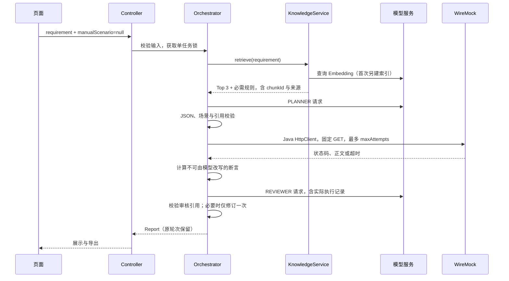

# API Fault Lab 实现与学习复盘

更新日期：2026-10-19。本文以实际代码、测试日志与浏览器操作为依据。
**本地核心流程已验证：55项测试通过，真实向量、无超时示例、双角色、HTTP、
规则变更、桌面/窄屏页面与报告导出通过。默认规则漏检已修复；
跨电脑、依赖完整审计和外部CI仍未验证。**
已实现对应调用链和验收脚本，不把协议桩或手动 PASS 当成远端 AI 联通。
2026-10-18 补充：提示词文件改为中文文件名，说明、注释、错误和导出报告优先中文；
真实最新结果见验收记录顶部补充，历史过程在后文保留。

2026-10-19 00:54后：保留真实向量Top-3，再去重补入 `timeout-rules.md` 的当前规则，
总上下文限制8片，补入片段score=null。真实原始需求不填超时即可规划1200ms，
隔离改为1400ms后模型使用新值；显式1900ms仍优先。没有硬编码默认数值。
证据50–53号JSON；55项完整测试及真实AI网页验证通过。

以下是此前过程。2026-10-19 首轮：JOJO 对话 + 硅基流动 BAAI/bge-m3 分工已实测，
向量为1024维，6片知识建库；恢复演练观察503、200，审核APPROVED。
隔离知识默认超时1200→1400，生成值同步变化，证明本次规则来自可变知识。
同时发现 Top-3 可能命中“引用规则的示例”却漏掉“规则定义”，模型因此要求澄清。
这是检索上下文完整性问题，当时尚未处理；不能把联通成功等同所有检索输入正确。
此次无生产源码变更；下文未特别注明的未联通描述为早期过程。

2026-10-18 23:10 补充：真实向量直接对照返回 429，应用复现返回 502；
同地址标准向量模型对照 404 / model_not_found。聊天仍可返回 200。
本次修复的是本地诊断信息丢失及异常链残留原始错误正文：
通过 Spring AI 的错误处理接口只读取 HTTP 状态码，保留证据且避免泄露。
新增 5 项测试后完整构建共 40 项通过；真实 Embedding 仍未通过。
这说明“程序错误处理已修复”和“远端模型能力已可用”是两个独立结论。

## 1. 用途与实际边界

这是独立的 Java / Spring Boot 练手工具，检验固定订单客户端在正常、
持续 5xx、延迟和失败后恢复时的有界行为。演练真正访问新建的回环 WireMock。
没有接入其他项目，没有访问外部项目的数据库、设备、固件或运行服务。

手动与AI模式均通过浏览器实际操作；AI完整编排同时具备协议桩和真实供应商证据，
真实向量、独立规划与审核、本地HTTP和知识变更样例均已通过。
项目不是生产混沌工程平台，不能证明真实生产系统可靠。
没有账号、持久数据库、向量数据库服务或云部署。

2026-10-19 依赖升级补充：为消除当前 OSV 扫描结果，项目迁移到 Spring Boot
4.1.1 / Spring Framework 7.0.9 / Spring AI 2.0.1，并使用 Tomcat 11.0.25、
Jackson 2.21.7、Jackson 3.1.7 和 Log4j 2.25.5。Spring AI 2.0 移除了旧版
OpenAI API 适配类，`AiGateway` 改为使用新客户端选项和 `OpenAIServiceException`
状态码映射，同时不再把供应商异常作为 cause 传播，避免敏感正文进入堆栈。
迁移后 55 项 Maven 测试通过，OSV Scanner 2.7.0 退出码 0 且漏洞记录为 0。

## 2. 选型与为什么这样做

| 选择 | 理由 | 代价与替代 |
|---|---|---|
| Boot 3.5.12 + AI 1.1.2 | 历史实现组合，保留作为迁移前记录 | 已迁移到 Boot 4.1.1 + AI 2.0.1；旧记录不代表当前依赖 |
| `--release 21` | 使用现代 Java record、HttpClient 生命周期，减少样板 | 运行基线为 Java 21+，当前只实际测试 Java 25 |
| WireMock standalone 3.13.2 | 复用有状态响应、延迟、请求日志；隔离 Jetty 依赖 | 每轮启动有固定开销，不适合做性能基准 |
| Spring AI 直接模型类 | 保留真实供应商协议适配，不引入 Agent 图框架 | 当前限定 OpenAI 兼容协议与 JSON object |
| SimpleVectorStore | 少量 Markdown 足够，无外部数据库 | 全量内存检索，不适合大规模语料 |
| 原生 HTML/CSS/JS | Boot 一并托管，无前端构建链 | 复杂交互增长后才考虑 Vue |
| 普通 Java 编排器 | 两角色、一次修订，用循环和分支即可读懂 | 不是通用工具调用平台 |

模型 API 的 Base URL、模型名和 Bearer 密钥可以分开配置。没有凭证时应用仍能启动，
手动模式不依赖 RAG；执行完成后可以独立调用一次受约束的 AI 辅助解释。
未把其他项目或生图凭证当成本项目授权。

## 3. 架构和一次请求



正常两次对话；第一次规划无法解析时，不执行 HTTP，使用唯一一次修正机会。
第一次执行后审核发现翻译错误时，保留该轮，再对同一需求修订并重新执行。
服务超时或鉴权失败立即结束，不无限重试。

## 4. 代码阅读路线

所有 Java 文件位于 `src/main/java/dev/apifaultlab/`：

1. `DrillModels.java`：先理解 Scenario、Attempt、Execution、Plan、Review、Round、Report。
2. `ScenarioValidator.java`：所有工程限值集中于这里；合法但无法恢复的配置仍允许执行。
3. `ScenarioRunner.java`：先不看 AI，跟着一轮真实 503、200 走完。
4. `KnowledgeService.java`：读文档、切片、向量化、缓存、查询。
5. `AiGateway.java`：供应商协议、超时、维度校验和脱敏元数据。
6. `PlannerAgent.java` / `ReviewerAgent.java`：两个独立系统指令，严格 JSON 解析。
7. `DrillOrchestrator.java`：唯一的业务顺序、任务锁和停止条件。
8. `DrillController.java`：API、异常到 HTTP 状态的映射、Markdown 导出。

`ApiFaultLabApplication` 只负责明确装配这些对象；没有多层透传 Service/Repository。
建议第一遍暂时忽略页面与模型，先运行 ScenarioRunnerTest，再返回整条链。

## 5. Java 知识与设计原因

**record 是数据模型。** Scenario 是配置，Attempt 是一次事实，Review 是模型判断，
三者没有混在一个 Map 里。字段明确后，Jackson 和编译器能帮忙发现结构问题。
record 本身只保证引用字段不可重新赋值，集合仍需要 `List.copyOf` 保留快照。

**集合承担证据顺序。** Attempt 使用有序 List，不能用无序 Set 存请求。
知识 ID 用集合归属检查，模型只能引用本次实际检索的片段。
报告缓存用 ConcurrentHashMap，任务串行用 AtomicBoolean 的 compareAndSet，
其目的不是追求高并发，而是准确拒绝同时提交。

**异常分业务类别。** 非法配置执行前抛 IllegalArgumentException；模型服务错误是 ModelFailure；
超时作为一种客户端观察被记录，不等于基础设施必然坏了。HTTP 200 只说明 API 返回了报告，
还要看报告状态与各轮断言。

**资源按生命周期清理。** 每轮新 WireMock，新客户端，finally 停止 WireMock。
HttpClient 使用 try-with-resources，不让上一轮恢复状态污染下一轮。
不会根据端口找任意进程来停止。

计时使用单调时钟 System.nanoTime，报告时间使用 Instant。耗时差不能用可被校时的墙钟计算。

## 6. 模型请求、结构和凭证

Spring AI 的 OpenAiChatModel 与 OpenAiEmbeddingModel 分别负责两类协议。
AiGateway 统一收集角色、模型、耗时、可获得的 token 用量与维度。
没有把认证头、完整敏感配置或原始供应商错误正文写入报告。

聊天要求 JSON object。Jackson 严格检查字段、缺失值、未知字段和尾随内容，
再由 Java 验证参数和引用。Prompt 的约束只是第一道引导，不是安全边界本身。
模型错误时，页面显示已完成的事实和失败阶段；不拼装假的模型答案。

每次网络调用有 1..120 秒的配置超时（默认 45 秒），供应商自动重试关闭。
HTTP/1.1 是实际定位本地传输问题后采用的兼容处理，详见问题记录。
没有测过某家真实服务时，不能保证其支持 JSON object 或当前接口路径。

`.env` 仅由启动脚本读入进程环境，忽略提交；Java 配置对象 toString 屏蔽凭证。
Base URL 不允许用户信息、查询串或片段，避免将认证信息藏入地址。
请求不会跟随重定向。页面只报配置存在性，不能据此推断联通。

## 7. RAG 是怎么落地的

知识在根目录 `knowledge/`，每份只解释一个项目主题。
按标题分节，每段最多 600 字符、重叠 60；短文档无需引入复杂分块框架。
每片带来源、标题、chunkId，chunkId 由来源与内容的 SHA-256 派生。

建库调用真实配置的 EmbeddingModel，将向量交给 SimpleVectorStore；
查询也生成 Embedding，再按余弦相似度取 Top 3，并补入当前 `timeout-rules.md` 原文。
使用LinkedHashMap按ID去重，保持主检索顺序，最多8片。补充规则score=null。
没有用关键词匹配替代真实向量，也没有把默认数值藏进Java。
命中片段原文与 ID 同时进入规划和审核请求。协议集成测试检查了两个实际请求体包含该文本，
但测试使用合成向量，不能证明远端模型的语义质量。

缓存清单绑定：知识内容、分块版本、Embedding 服务地址、模型名、维度与索引文件摘要。
重启后缓存匹配才加载；先做维度探测，查询再生成一条向量，不重新嵌入全部文档。
文件改变会使状态显示 STALE，并在下次查询自动重建；按钮也可显式重建。
缺少可读知识文件、空向量、非有限向量或维度漂移会失败。

`LAB-DEFAULT-TIMEOUT` 是本项目特定规则，位于 `timeout-rules.md`。
它不能写死在规划代码中，否则“改知识后输出更新”无法证明 RAG 起作用。
已提供隔离副本的真实规则变更脚本；真实服务配置缺失时不计 PASS。

实际遇到Top-3漏掉示例依赖规则：本轮用真实模型复现后补齐规则原文；
仅靠提高相似度排名不能保证必要规则一定出现，补齐也不保证所有未来依赖自动展开。
限制：相似度不是正确率，当前必需规则仅限 `timeout-rules.md`，其余召回质量需继续验证。
同名模型在同维度内被供应商更换语义空间时，指纹无法自动发现，需要重建。

## 8. 两个角色与修订

Planner 只负责将需求变成 Scenario、解释与知识引用，也可以提出澄清。
Reviewer 使用另一条真实聊天请求，检查需求、配置、知识、HTTP 记录和断言。
两者可以用同一个模型，区别在职责、系统指令和输入。

普通两轮以内的循环足够：

```java
chunks = knowledge.retrieve(requirement);
plan = planner.plan(requirement, chunks, correction);
validate(plan);
execution = runner.execute(plan.scenario());
review = reviewer.review(requirement, chunks, round);
```

循环上限为 2，不是“直到成功”。NEEDS_REVISION 只允许配置翻译或引用问题，
翻译问题必须提供需求中的原文摘录。EVIDENCE_INSUFFICIENT 不触发重规划。
JSON/配置校验错误同样只占用唯一修正机会。
每轮都保存，不覆盖原来的 FAIL，也不为 PASS 自行调整参数。

Java 无法形式化证明模型对自然语言的每次解释都正确；原文摘录与引用校验仍只是有限防线。
没有实测双角色比单模型准确，不能宣称准确率提升。

## 9. 程序断言与模型判断

用户要求“失败两次之后恢复，最多请求两次，期望恢复”：

- 真实记录只能是 503、503。
- 第三次请求根本没有额度。
- observedOutcome=EXHAUSTED，expectedOutcome=RECOVERED，程序 FAIL。
- 若审核确认需求翻译、次数与报告一致，可返回 APPROVED。

若用户本来就想验证错误耗尽，把 expectedOutcome 明确改为 EXHAUSTED，
同样的实际记录可以 PASS。这是断言目标改变，不是客户端变可靠。
页面始终把程序结果与审核状态分开。
报告还包含次数上限、固定正文和截止时间断言。

## 10. 实际问题与证据

完整过程见 [开发问题记录](开发问题记录.md)，没有将假设包装成已解决经历。

| 问题 | 证实原因或边界 | 处理与验证 |
|---|---|---|
| Maven 不在 PATH | 已安装在 IDEA 内，非未安装 | 使用明确路径，未改系统环境 |
| WireMock 方法编译错误 | 错误假定有布尔重载 | 使用默认请求日志，真实请求测试回归 |
| 模型本地 POST 失败 | HTTP/2 连接 EOF/中止，URL 正确 | HTTP/1.1，实际协议 POST 测试通过 |
| 缓存多一次 Embedding | 向量库观测调用默认 dimensions() | 固定已验证维度，缓存测试次数正确 |
| 12ui 安装 spawn EINVAL | 工具内部原因 UNKNOWN | 原生单页；未声称工具已修复 |
| Playwright 缓存不匹配 | 包需 1234，缓存为 1228 | 指定已安装 Edge，真实浏览器交互通过 |
| Windows 锁定运行 JAR | 打包无法重命名本项目已启动 JAR | 核实并停止本次自建进程，35 项测试与重打包通过 |
| 收尾测试/扫描脚本错误 | AssertJ 签名与 Git 中文路径转义 | 修正验证工具后重跑，不将不完整扫描记成 PASS |
| 默认规则没进入Top-3 | 场景示例被命中、其引用的规则被漏掉 | 去重补入当前规则原文，45项测试及真实原始需求通过 |

页面按交接文档固定工具方向实现，未完成设计技能的概念抽签/独立设计稿流程，
没有补造 seed、设计审批或图像稿。独立页面审阅依据实际截图，结论不扩大到真实 AI。

TDD 证据包括未实现执行器、RAG/模型适配器、编排器与端点的失败日志，以及后续通过日志。
最新测试数量和命令以 [验收记录](验收记录.md) 为准。

## 11. 运行、练习与限制

启动和测试命令见 README。页面打开不触发全量建库，只有主动提交或重建才调用模型。
更换模型配置需重启本项目；知识文件变更无需重启。

三个练习：

1. 手动恢复场景：failureCount 从 1 改为 2，maxAttempts=3，应该观察 503、503、200。
2. 再把 maxAttempts 改成 2，保留 expectedOutcome=RECOVERED，解释为何 FAIL，为什么没有第三次。
3. 配好真实服务后修改临时知识中的默认超时，重建索引，比较指纹、命中片段与生成值。
   可以执行 `scripts/verify-rag-change.ps1`，它不修改跟踪知识或停止现有服务。

第一轮学习（约 20 分钟）：只看模型对象、参数校验和真实 HTTP 测试。
第二轮（约 30 分钟）：看 RAG 分块、缓存、AiGateway 和 Prompt。
第三轮（约 30 分钟）：看编排器的一次修订与报告；自己解释一次失败记录。
这些是阅读建议，不是完成能力的承诺。

已验证本次真实供应商调用、具体样例的检索与双角色、规则变更以及网页报告。
仍未验证：广泛输入下的检索召回和模型正确率、跨电脑启动、生产适用性、
完整传递依赖许可证和安全扫描、外部 GitHub CI。

## 12. 简历与面试边界

### 12.0 本次新增：受约束的 AI 辅助

手动和真实只读模式都由 Java 先完成固定执行，再调用一次 `AiAssistanceService`。
辅助输入是白名单重组的 JSON，不接受模型返回配置：

- 手动模式发送原始需求、Java 已校验的 `Scenario` 字段，以及仅含状态码、耗时、
  客户端观察、断言名称/布尔值和请求计数的执行摘要；不发送 HTTP 响应正文或目标地址。
- 真实只读模式只发送每次请求的 HTTP 状态、耗时、记录数、
  `responseShapeValid`、`deviceIdMatches`、`sampleTimePresent`、`hasMetric`。
  设备 ID、传感器值、采样时间文本、固定 URL 和响应正文不进入模型请求。
- AI 返回严格只允许 `explanation` 与 `findings` 两个字段。Java 不读取或合并任何
  配置字段，程序状态、HTTP 记录和断言永远来自执行器。
- 辅助失败保存为 `AiAssistance.status=FAILED`，不改变手动或只读报告的 `status`；
  页面和 Markdown 报告分开展示这两个状态。

本次 TDD 回归新增 4 项辅助测试，配合既有测试共 **55 项通过**。本地协议桩只证明
请求字段与边界装配正确；真实远端辅助模型是否对当前供应商、当前模型和当前配置成功，
本次仍需独立门禁，不能由协议桩或 HTTP 200 推断。

### 12.1 本次新增：真实只读模式

只读模式与 WireMock 故障演练完全分开。程序不让模型产生目标地址，而是从被忽略的
`runtime/readonly-target.json` 读取设备 ID；主机必须是预先允许的本机回环地址，
方法和路径在 `ReadOnlyProbeService` 中固定。一次运行最多 3 次串行请求，超过上限在发送前拒绝。

每个响应只在内存中解析四类业务事实：统一业务码为 200、分页结构合理、记录的设备 ID
匹配、采样时间与至少一个指标存在。`ProbeAttempt` 只保留状态码、耗时、布尔断言和记录数，
不保存传感器值、设备 ID、采样时间或响应正文，因此不能把完整遥测送入模型或公开报告。

为避免目标服务的隐式写入，工具选用固定分页查询；目标服务的全局访问审计仍可能追加日志。
这不是“零副作用”承诺，而是“业务查询只读、审计写入”的明确边界。真实 PASS 只表示当前
本地服务在当前设备 ID 下满足这些业务断言，不代表硬件、数据库或生产可靠性。

快捷启动器 `launch.ps1` 先用 `runtime/server.pid` 和精确 JAR 命令行识别本项目实例，
已运行则复用其 URL；未运行才调用现有 `start.ps1`。它不会杀掉占用端口的其他进程，
也不会自动启动其他服务。`scripts/create-shortcut.ps1` 生成桌面入口。

依据本次实际结果可如实说：

> 使用 Java / Spring Boot 实现本地接口异常演练工具，复用 WireMock 执行四类有界 HTTP 场景；
> 接入真实对话与Embedding模型，实现向量检索、必需规则上下文与规划/审核双角色编排；
> 通过55项自动化、真实HTTP与网页样例验证，并演示知识规则变化后配置同步更新。

上述是本地样例及软件测试证据，不能扩大成普遍正确率或真实业务系统验收。
不要写已上线、企业级、高并发或未经测量的准确率/性能增益。

面试自问：

- 为什么用 WireMock？复用成熟故障模拟，自己的工作集中在约束、编排和证据。
- RAG 能否用全文 Prompt 替代？小知识库可以；这里用 RAG 是为了学习可追溯检索与索引更新。
- Embedding 与聊天有什么区别？前者把文本放入可比较的向量空间，后者生成/审核结构化内容。
- 两个角色是否就是两个不同大模型？不是，可以同一模型、不同调用和职责。
- 不合法输出怎么办？严格解析和 Java 校验，最多一次修订，再错就终止。
- 为什么审核通过不等于 PASS？审核检查报告是否诚实一致，程序检查预期是否满足。
- 什么时候才需要图引擎？当工具选择、分支、并发和恢复状态明显复杂时，而非只有两个固定步骤时。
